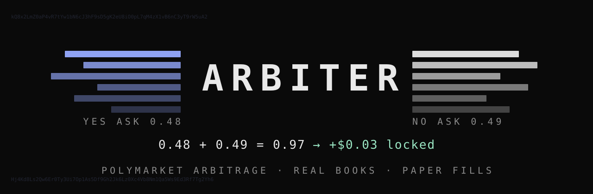
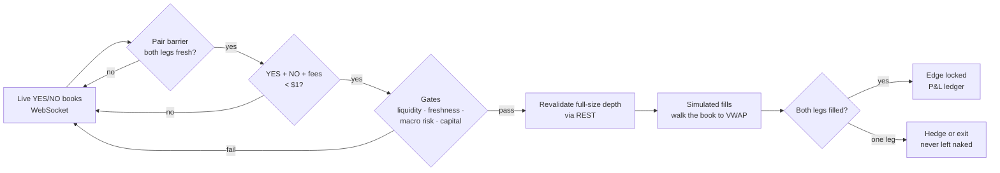

<p align="center">
  
</p>

<p align="center">
  
  
  
  
</p>

<p align="center"><b>Every binary market pays exactly $1. Arbiter watches for the moment both sides cost less.</b></p>

---

## The idea in one line

A Polymarket binary has two outcomes. One settles at **$1**, the other at **$0**. Hold one share of each and you collect $1 no matter what happens:

```text
combined cost = YES ask + NO ask
locked edge   = 1.00 − combined cost − fees
```

When the two asks add up to less than a dollar after fees, the difference is locked in before the market resolves. Arbiter finds those moments in live order books, checks that the depth is real, and simulates the fills.

## Two engines

| | **`btc5m/`** | **`universe/`** |
|---|---|---|
| **Scope** | Polymarket's BTC 5-minute YES/NO windows | The whole active market set, 2,000+ markets |
| **Strategy** | Simultaneous pair: buy both sides at once | Sequential pair: one side near 50/50 early, the other side later |
| **Edge check** | 10 ms pair barrier, then REST revalidation of full-size depth | Depth-walked fills priced against Polymarket's taker-fee curve |
| **Dashboard** | Streamlit, with a hash-verified demo replay | FastAPI + WebSocket push, one live page |
| **Extra signal** | LightGBM volatility regime, exported for the universe engine | Reads that regime to tune BTC first-entry thresholds |

`universe/` started as a fork of `btc5m/`. It generalized one rotating BTC window into N concurrent markets and split a monolithic execution module into focused parts: an order router, fill tracker, partial-fill recovery and P&L ledger.

## How a trade is decided



- **The pair barrier** stops a fresh YES update from being paired with a stale NO quote, the classic way a backtest invents edge that isn't there.
- **Revalidation** re-fetches both books right before reserving capital. If the edge vanished in those milliseconds, nothing trades.
- **Partial fills are real.** Thin depth is not promoted to a full fill. If only one leg fills, the engine cancels, hedges or crosses the bid to get flat.

## Proof it runs

Validated against live Polymarket data, not just unit tests:

| Check | Result |
|---|---|
| Universe discovery | **2,070** markets discovered → **73** qualified → **50** promoted to active tracking |
| Trading loop | 50 markets subscribed, **100/100** YES/NO updates paired correctly |
| Stability | **2+ hours** on live data, **0** errors, ~67 MB memory, two real WebSocket drops recovered on their own |
| Dashboard | Start/stop through a real state machine; stop returns in ~0.03 s mid-run |
| Tests | **965 passing** (806 `btc5m` · 159 `universe`) |

And the honest part: in the validation window **the edge gate found no arbitrage**. That's the correct answer for an efficient book, not a bug. A detector that never cries wolf is the point.

## Safety by design

Arbiter is a research and paper-trading system. Real money can't move:

- **No live order path in `universe/`.** Submission isn't gated or flagged off, it simply isn't implemented.
- **A hard block in `btc5m/`.** The dashboard has an audited operator flag, but a separate code-level block keeps live submission off even when the flag is armed. Every submission boundary logs that state.
- **Read-only wallet checks.** Only `eth_getBalance` and `eth_call` are allowed. The checker has no way to send a transaction.
- **Jurisdiction respected.** A blocked region stays blocked; nothing tries to route around it.
- **Sealed evidence.** Every paper session is archived with a `SHA256SUMS` seal, and the dashboard rejects archives whose seal doesn't match.

## Quick start

```bash
git clone https://github.com/RyFinance/arbiter.git
cd arbiter
```

**Universe scanner** (no wallet needed in dry-run):

```bash
cd universe
python3 -m venv .venv && .venv/bin/pip install -e ".[dev]"
cp .env.example .env            # DRY_RUN=true by default
.venv/bin/python -m polyuni.main
.venv/bin/uvicorn dashboard.server:app --port 8811   # http://localhost:8811
```

**BTC 5-minute engine:**

```bash
cd btc5m
python3 -m venv .venv && .venv/bin/pip install -r requirements.txt
.venv/bin/python scripts/setup_wizard.py --profile dry-run
.venv/bin/python -m polymarket_arb.main
.venv/bin/streamlit run streamlit_app.py
```

The setup wizard only writes `dry-run` and `paper` profiles. It validates every setting before saving, and the `.env` it creates is readable only by you.

**Tests:**

```bash
(cd btc5m && .venv/bin/pytest -q)
(cd universe && .venv/bin/pytest -q)
```

A few `btc5m` tests need local model and data files that aren't in the repo. They skip with a reason; set `ARBITER_LOCAL_ARTIFACTS=1` to run them where those files exist.

## Layout

```text
arbiter/
├── btc5m/            BTC 5-minute pair engine, Streamlit dashboard, research & edge mining
│   ├── polymarket_arb/   detector, execution, risk, alerting, live-control hard block
│   ├── scripts/          setup wizard, sealed paper sessions, preflight checks
│   ├── edge_mining/      adverse-selection and edge studies
│   └── tests/
└── universe/         2,000+ market scanner, sequential strategy, WebSocket dashboard
    ├── polyuni/          universe lifecycle, execution split, fee math, regime input
    ├── dashboard/        FastAPI + WebSocket UI
    └── tests/
```

---

<p align="center">
  Built by <a href="https://x.com/slime2riches">@slime2riches</a> · <a href="https://slimecode.tech">slimecode.tech</a><br>
  <sub>Research and paper trading only. Nothing here is financial advice.</sub>
</p>
